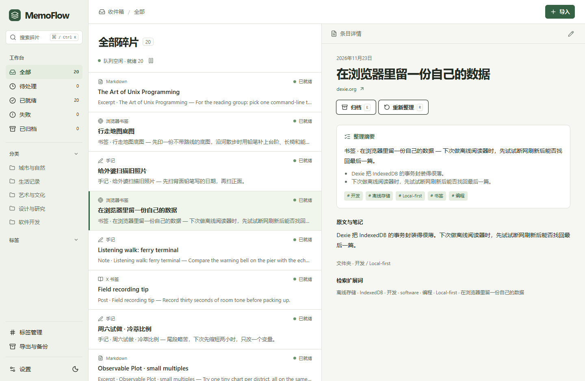
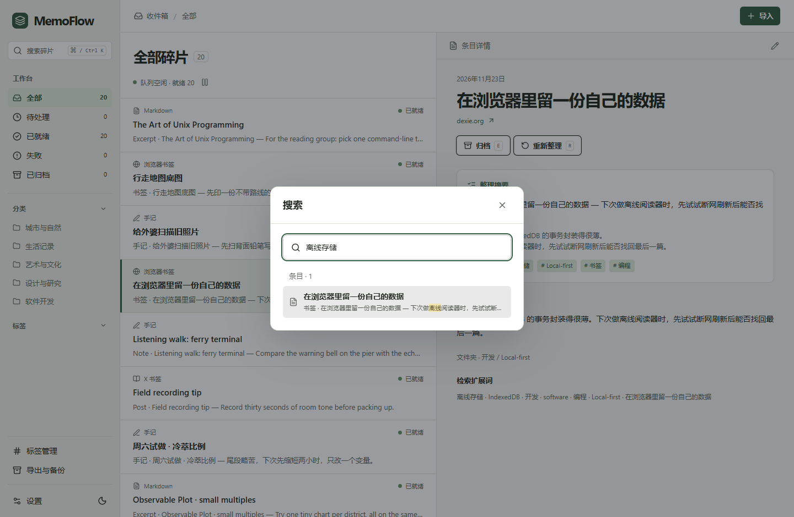
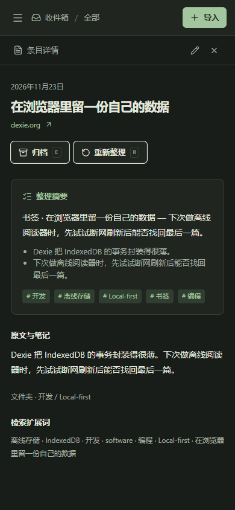

# MemoFlow

MemoFlow 是浏览器里的本地优先收藏收件箱。把 X 书签、浏览器书签或零散网址导入后，可以按摘要、标签、中英文关键词查找条目，再导出到 Markdown 或 Obsidian。首次使用直接运行本地 Mock 引擎，无需账号或 API 密钥。

## 界面预览

加载 20 条内置收藏后，左栏可按状态、分类或标签筛选，中栏选择条目，右栏查看整理摘要、原文和检索扩展词。



<details>
<summary>查看中文搜索与手机端截图</summary>

输入「离线存储」，可以找到标题里没有这四个字的笔记《在浏览器里留一份自己的数据》。



手机宽度下，点开条目即可单独阅读。下图为深色主题。



</details>

## 本地启动

使用 Node.js **24.20.0** 可复现本项目的本机运行环境。使用 Node 24 的其他版本时，当前锁定的 jsdom 需要 **24.15.0 或以上**。在仓库根目录运行：

```sh
npm ci
npm run dev
```

打开终端打印的本地网址。选择 **导入 → 加载演示数据**，即可体验 20 条中英混合收藏。新条目会自动进入整理队列。队列显示“就绪 20”后，按 `Ctrl+K`（macOS 为 `⌘K`），输入“离线存储”试搜。

## 导入和整理

- **导入**支持 X 书签 JSON、Netscape 书签 HTML、含 Markdown 链接或裸网址的 Markdown / TXT 文件。也可选好格式后直接粘贴。完成提示会列出新增数和重复数，重复导入保留已有条目。
- **工作台**可切换处理状态、查看原文与 AI 整理卡片。列表里按 `j` / `k` 选择下一个或上一个，`e` 切换归档，`r` 重新加入整理队列。队列支持暂停、继续与失败重试。
- **标签管理**可重命名或合并标签。点击侧栏主题可浏览相关条目。

## 架构

MemoFlow 是 Vite 构建的 React 19、TypeScript 单页应用，Tailwind CSS 和本地样式负责界面。三个导入解析器只读取提供的文件或文本。写入前按规范 URL 或文本生成 SHA-256 指纹，Dexie 在 IndexedDB 事务中去重保存，React 通过 `useLiveQuery` 订阅变更。

后台队列使用 Web Locks 协调同一站点的多个标签页，把处理状态与结果写回条目。MiniSearch 在打开搜索时建立内存索引，英文按词、中文按双字组合查找，同时检索原文与 AI 扩展词。列表每页显示 60 条，搜索范围覆盖整个收件箱。ZIP 下载通过浏览器中的 fflate 生成。

## 使用自己的模型

在 **设置** 中选择 DeepSeek、Gemini（OpenAI 兼容）、OpenAI 或本地 Ollama，确认基础地址、模型名和 API Key 后保存。基础地址填到 API 路径前缀，例如 `https://api.openai.com/v1`。应用会自行追加 `/chat/completions`。并发数默认为 2，可设为 1 至 5。

收藏和整理结果保存在当前站点的 IndexedDB，API Key 和提供方设置保存在该站点的 localStorage。Mock 在浏览器内处理内容；使用其他提供方时，浏览器会向配置的 API 地址发送待处理条目的标题、原文、网址、作者和书签目录，并在有密钥时附带认证头。模型只分析已导入材料。远端端点需要 HTTPS，并允许来自应用站点的跨域请求。本机 Ollama 预设为 `http://localhost:11434/v1` 和 `qwen2.5:7b`，需要该服务已启动并可从浏览器访问，且已安装所选模型。

## 导出、备份与迁移

- **导出与备份 → 导出 Markdown** 生成一份汇总文档。**导出 Obsidian ZIP** 为每条记录生成一篇带 YAML 属性的笔记，可解压到 Obsidian 仓库。
- **导出全量 JSON** 保存全部条目、原文、AI 结果、标签和处理状态。密钥、提供方及界面偏好只保存在原浏览器。清除站点数据、切换浏览器或部署域名之前，可先下载 JSON。
- **恢复 JSON** 会显示替换确认。确认后先校验所有条目及其指纹，再以单一数据库事务替换全部现有记录。无效备份会报错并保留现有数据。备份中处于“整理中”的条目恢复为“待处理”，供队列重新执行。

## 验收和预览

Windows 上的 E2E 使用本机 Microsoft Edge。其他系统首次测试前运行 `npx playwright install chromium` 安装 Chromium；Linux CI 可用 `npx playwright install --with-deps chromium` 一并安装系统依赖。然后依次运行：

```sh
npm run typecheck
npm run test
npm run build
npm run test:e2e
```

单元测试使用模拟 IndexedDB。浏览器测试使用独立浏览器上下文与本地构建产物，覆盖 Mock 整理、中文搜索、快捷键、备份恢复、响应式布局及 1,000 条数据的导入、滚动和查找。E2E 自动启动和关闭所需站点。手动查看生产构建时，在 `npm run build` 后运行 `npm run preview`。

要单独复现 1,000 条数据测量，可在生产构建后运行 `npm run test:e2e -- tests/e2e/performance.spec.ts`。用例暂停 AI 队列，计时真实文件导入、IndexedDB 写事务、首次建索引、中文查询和界面切换。毫秒数输出在终端。

## 静态部署

把整个 `dist/` 放在 HTTPS 静态站点的根路径或带结尾斜杠的项目子路径下，例如 `/memoflow/`。Vite 使用相对资源路径，首页、图标、样式和按需加载的导出模块可随目录一起移动。不同源（协议、主机或端口不同）各自保存浏览器数据，可用全量 JSON 迁移。

- **Vercel**：导入仓库，以仓库根目录作为项目目录，构建环境选择 Node.js 24.x。`vercel.json` 配置了 Vite、`npm ci`、`npm run build` 和输出目录 `dist`。[Vercel 静态配置](https://vercel.com/docs/project-configuration/vercel-json)
- **GitHub Pages**：将工作流放在仓库默认分支，在仓库的 **Settings → Pages → Build and deployment → Source** 选择 **GitHub Actions**。随后在 **Actions → Publish MemoFlow to GitHub Pages → Run workflow** 手动启动。工作流完成类型检查、单元测试、构建和浏览器测试后发布 `dist/`。[GitHub Pages 发布来源](https://docs.github.com/en/pages/getting-started-with-github-pages/configuring-a-publishing-source-for-your-github-pages-site) · [自定义 Pages 工作流](https://docs.github.com/en/pages/getting-started-with-github-pages/using-custom-workflows-with-github-pages)
